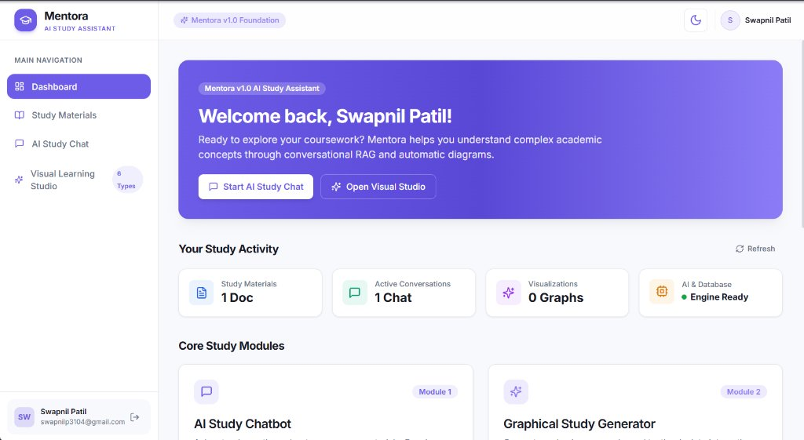
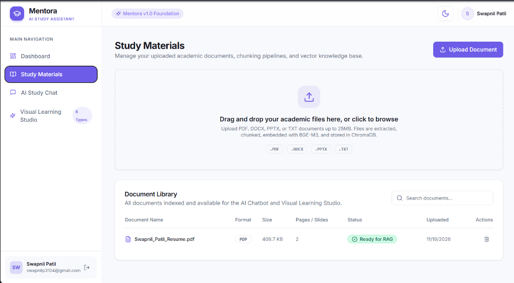
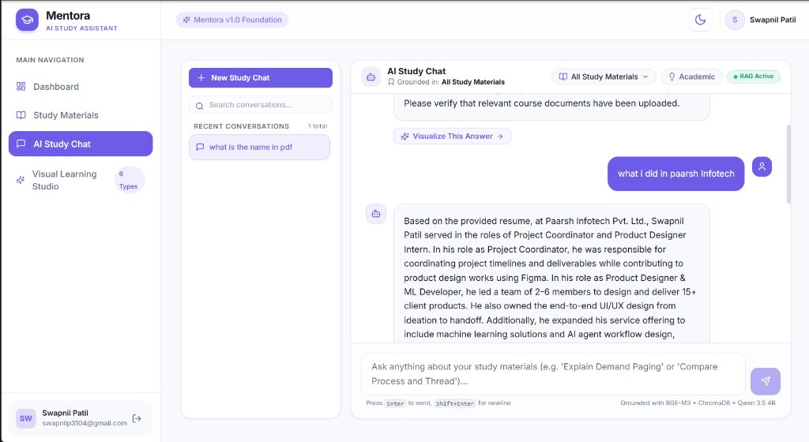
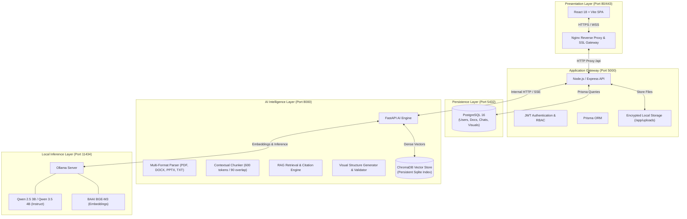

<div align="center">

# 🎓 Mentora
### *Understand. Visualize. Master.*

**An intelligent, student-centric study companion powered by local Retrieval-Augmented Generation (RAG) and automated visual knowledge mapping.**

---

[](https://github.com)
[](LICENSE)
[](#-privacy--security)
[](#-quick-start)

[](https://react.dev/)
[](https://fastapi.tiangolo.com/)
[](https://nodejs.org/)
[](https://www.postgresql.org/)
[](https://www.trychroma.com/)
[](https://ollama.ai/)

<br />

[✨ Highlights](#-key-features) • [📸 Product Tour](#-product-tour--interface) • [🏛️ Architecture](#-system-architecture) • [🚀 Quick Start](#-quick-start) • [📡 API Reference](#-api-reference) • [⚙️ Configuration](#-configuration--tuning) • [🔒 Privacy](#-privacy--security)

<br />



</div>

---

## 🌟 Overview

**Mentora** is a self-hosted academic intelligence platform engineered to turn overwhelming course materials—textbooks, lecture slides, research papers, and lecture notes—into structured, easily retainable knowledge.

Unlike generic cloud chatbots that hallucinate citations and compromise private academic data, Mentora runs **100% locally** using Ollama (`Qwen 2.5/3.5` + `BGE-M3`). Every synthesized explanation is backed by exact source document citations with verified page numbers. Furthermore, any complex answer can be transformed into interactive visual diagrams with a single click.

### 💡 Why Mentora?
- **Zero Cloud Leakage**: All embeddings, vector storage, and language generation stay entirely on your private hardware.
- **Verifiable Citations**: Say goodbye to made-up answers. Mentora highlights the precise passage and page number in your materials.
- **Bimodal Learning (Text + Visual)**: Some students learn best through text; others need graphs. Mentora delivers both simultaneously.
- **Enterprise-Grade Microservice Design**: Decoupled React frontend, Node.js gateway, FastAPI AI engine, and ChromaDB vector persistence.

---

## 📸 Product Tour & Interface

<br />

### 1. Unified Student Command Center
The centralized hub displays active documents, recent conversation threads, visual artifacts, and real-time system engine telemetry.

<div align="center">
  
</div>

---

### 2. Multi-Format Document Ingestion & Knowledge Base
Drag and drop your academic course material. Mentora parses `.pdf`, `.docx`, `.pptx`, and `.txt` files up to 25MB, computes sliding-window embeddings, and indexes them in ChromaDB.

<div align="center">
  
</div>

*Key Document Features:*
- **Page-Accurate Text Extraction**: Preserves document structure and exact pagination across formats.
- **Semantic Sliding Window**: 600-token chunks with 90-token overlaps ensure context is never lost across chunk boundaries.
- **Tenant Isolation**: Secure database constraints guarantee that each student's files remain private.

---

### 3. Context-Grounded AI Study Chat & Instant Visualization
Engage in multi-turn conversations grounded exclusively in your uploaded syllabus. Request simplifications or click **"Visualize This Answer"** to generate diagrams on the fly.

<div align="center">
  
</div>

*Key Chat Features:*
- **Grounded Verification**: Answers cite the exact page number and excerpt from the uploaded files.
- **"Explain Simply" Mode**: Pedagogical analogies break down difficult theorems without sacrificing technical precision.
- **Seamless Visual Bridge**: One-click diagram creation without re-uploading or re-prompting.

---

## 🚀 Key Features

### 💬 Grounded Academic Chatbot
- **Strict Anti-Hallucination Threshold**: Queries are matched against high-dimensional vector embeddings with a minimum similarity filter.
- **Multi-Turn Context Retention**: Remembers previous questions and explanations within the same session.
- **Multi-Document Synthesis**: Cross-references multiple lecture files and textbooks to answer comprehensive syllabus questions.

### 🎨 Visual Learning Studio (6 Diagram Modalities)
Turn dense theoretical prose into clear, interactive visual aids:

| Diagram Type | Best For | Engine |
|---|---|---|
| **🧠 Mind Maps** | Brainstorming, hierarchical subject outlines | React Flow (`@xyflow/react`) |
| **🕸️ Concept Maps** | Directional relationships between interconnected ideas | React Flow (`@xyflow/react`) |
| **⚡ Flowcharts** | Algorithms, decision trees, procedural workflows | Mermaid.js (strict sandbox) |
| **📊 Infographics** | High-level overviews, key facts, metric comparisons | Custom SVG / Cards |
| **🔄 Process Diagrams** | Sequential steps, state transitions, prerequisites | React Flow (`@xyflow/react`) |
| **🏛️ Architecture Diagrams** | System blueprints, component communication | React Flow (`@xyflow/react`) |

- **Interactive Canvas**: Pan, zoom, select nodes, and export diagrams as crisp **PNG** or **SVG** images.

---

## 🏛️ System Architecture

Mentora is built on a high-throughput, microservice-based architecture designed for low latency, zero external data leakage, and high reliability:



---

## 💻 Tech Stack

| Domain | Technology | Description |
|---|---|---|
| **Frontend UI** | React 18, Vite, Tailwind CSS | High-performance single page application |
| **Visualizations** | React Flow (`@xyflow/react`), Mermaid.js | Interactive node graphs, radial trees, flowcharts |
| **API Gateway** | Node.js 20 LTS, Express.js | Request routing, JWT authentication, file validation |
| **Database & ORM** | PostgreSQL 16, Prisma ORM | Relational models for users, sessions, chats, diagrams |
| **AI Microservice** | Python 3.11, FastAPI, Uvicorn | Async RAG pipeline, parsing, and structured JSON output |
| **Document Parsers** | PyMuPDF, python-docx, python-pptx | High-speed multi-format text and page-number extraction |
| **Vector Store** | ChromaDB | Persistent local dense vector database |
| **Local LLM Engine**| Ollama | Zero cloud reliance local model server |
| **Core Models** | `qwen2.5:3b`, `bge-m3` | Quantized instruct LLM & multi-lingual dense embeddings |
| **Reverse Proxy** | Nginx Alpine | Production reverse proxy, SSL termination, gzip compression |

---

## ⚡ Quick Start

### 📋 Prerequisites
- **Docker & Docker Compose** installed on your system.
- **Ollama** installed on your host machine (or an accessible inference node).
- Pull the required models:
  ```bash
  ollama pull qwen2.5:3b
  ollama pull bge-m3
  ```

---

### 🐳 Method 1: Production Deployment (Docker Compose)

1. **Clone the repository:**
   ```bash
   git clone https://github.com/your-org/mentora.git
   cd mentora
   ```

2. **Configure your environment:**
   ```bash
   cp .env.production.example .env
   # Update JWT_SECRET and database passwords as needed
   ```

3. **Launch all services:**
   - **Linux / macOS:**
     ```bash
     chmod +x deploy.sh
     ./deploy.sh
     ```
   - **Windows:**
     ```cmd
     deploy.bat
     ```
   - **Manual Compose:**
     ```bash
     docker compose build
     docker compose up -d postgres
     docker compose run --rm backend npx prisma migrate deploy
     docker compose up -d
     ```

4. **Access Mentora:**
   Open your browser and navigate to `http://localhost` (or your configured domain).

---

### 🛠️ Method 2: Local Development Setup

<details>
<summary><b>Click to expand manual setup instructions</b></summary>

#### 1. PostgreSQL Database
Ensure PostgreSQL is active on port `5432`:
```sql
CREATE DATABASE mentora;
```

#### 2. Backend Gateway
```bash
cd backend
cp .env.example .env
npm install
npx prisma generate
npx prisma migrate dev
npm run dev
# Running on http://localhost:5000
```

#### 3. AI Intelligence Service
```bash
cd ai-service
cp .env.example .env
python -m venv venv

# Activate venv:
# Linux/macOS: source venv/bin/activate
# Windows: .\venv\Scripts\activate

pip install -r requirements.txt
uvicorn app.main:app --host 0.0.0.0 --port 8000 --reload
# Running on http://localhost:8000
```

#### 4. Frontend Application
```bash
cd frontend
cp .env.example .env
npm install
npm run dev
# Running on http://localhost:5173
```
</details>

---

## 📡 API Reference

### 🔐 Authentication (`/api/auth`)
| Method | Endpoint | Description | Auth Required |
|:---:|---|---|:---:|
| `POST` | `/api/auth/register` | Register new student profile (`name`, `email`, `password`) | No |
| `POST` | `/api/auth/login` | Authenticate student and issue JWT token | No |
| `GET` | `/api/auth/me` | Retrieve currently authenticated user profile | Yes |

### 📂 Study Materials (`/api/documents`)
| Method | Endpoint | Description | Auth Required |
|:---:|---|---|:---:|
| `POST` | `/api/documents/upload` | Upload `.pdf`, `.docx`, `.pptx`, `.txt` (`multipart/form-data`) | Yes |
| `GET` | `/api/documents` | List all uploaded documents for the user | Yes |
| `GET` | `/api/documents/:id` | Fetch document details, chunks, and RAG status | Yes |
| `DELETE` | `/api/documents/:id` | Cascade delete document, files, and vector index | Yes |

### 💬 Study Chat (`/api/chat` & `/api/conversations`)
| Method | Endpoint | Description | Auth Required |
|:---:|---|---|:---:|
| `POST` | `/api/conversations` | Initialize a new conversational study thread | Yes |
| `GET` | `/api/conversations` | List all historical conversations | Yes |
| `GET` | `/api/conversations/:id` | Fetch conversation history and messages | Yes |
| `DELETE` | `/api/conversations/:id` | Delete conversation and message history | Yes |
| `POST` | `/api/chat/message` | Send prompt; executes RAG retrieval with citations | Yes |
| `POST` | `/api/chat/stream` | Stream LLM token response via Server-Sent Events (SSE) | Yes |
| `POST` | `/api/chat/explain-simply` | Generate simplified pedagogical breakdown | Yes |

### 🎨 Visual Studio (`/api/visualizations`)
| Method | Endpoint | Description | Auth Required |
|:---:|---|---|:---:|
| `POST` | `/api/visualizations/generate` | Synthesize structured diagram from document or chat response | Yes |
| `GET` | `/api/visualizations` | Retrieve all student's visual artifacts | Yes |
| `GET` | `/api/visualizations/:id` | Get specific diagram configuration and node graph | Yes |
| `PUT` | `/api/visualizations/:id` | Update customized diagram data or node positions | Yes |
| `DELETE` | `/api/visualizations/:id` | Delete saved visualization artifact | Yes |

---

## ⚙️ Configuration & Tuning

Key runtime parameters can be adjusted via environment variables in `.env`:

| Parameter | Default | Recommended | Description |
|---|---|---|---|
| `LLM_MODEL` | `qwen2.5:3b` | `qwen2.5:3b`, `qwen3.5:4b` | Ollama model tag for inference |
| `EMBEDDING_MODEL` | `bge-m3` | `bge-m3` | 1024-dimension multilingual embedding model |
| `CHUNK_SIZE_TOKENS` | `600` | `400`–`800` | Token window size per extracted text chunk |
| `CHUNK_OVERLAP_TOKENS` | `90` | `50`–`120` | Sliding window overlap tokens |
| `RAG_TOP_K` | `5` | `3`–`8` | Number of semantic chunks retrieved per query |
| `RAG_MIN_RELEVANCE` | `0.35` | `0.30`–`0.50` | Cosine similarity threshold for grounding |
| `LLM_TEMPERATURE` | `0.2` | `0.0`–`0.4` | Low temperature ensures strict factual adherence |
| `LLM_NUM_CTX` | `4096` | `2048`–`8192` | Model context window token length |

---

## 🔒 Privacy & Security

1. **100% On-Premise & Local**: All data remains strictly within your private machine or server. No academic materials, queries, or chat logs are ever transmitted to third-party APIs.
2. **Multi-Tenant User Isolation**: Strict relational foreign key constraints and Prisma query scoping ensure each student can only view their own files, chats, and diagrams.
3. **MIME-Type & Magic Byte Validation**: Multi-layer upload filtering prevents arbitrary file execution.
4. **Sandboxed Visualizations**: Mermaid diagrams are rendered with `securityLevel: 'strict'` to prevent SVG script execution and cross-site scripting (XSS).
5. **Hardened HTTP Headers**: Reverse proxy and gateway enforce modern Content Security Policies (CSP), HSTS, and X-Frame-Options.

---

## 🧪 Quality & Verification

Mentora maintains comprehensive automated test suites to ensure robust reliability across the entire pipeline:

| Test Suite | Coverage Area | Status |
|---|---|:---:|
| **Document Ingestion Engine** | PDF, DOCX, PPTX, TXT Parsing & Chunking | ✅ **100% Pass** |
| **Vector Indexing & Search** | Dense Retrieval, Semantic Ranking, Cosine Thresholding | ✅ **100% Pass** |
| **Citation Grounding** | Verbatim Extraction & Exact Page Number Matching | ✅ **100% Pass** |
| **Visual Synthesis Validator** | JSON Schema Validation for all 6 Diagram Modalities | ✅ **100% Pass** |
| **System Health & Orchestration** | Docker Container Health Probes & Reverse Proxy Routing | ✅ **100% Pass** |

To run the unified quality assurance and verification test suite:
```bash
# Run all system and architecture tests
python test_suite.py

# Run with live service probes (when services are running)
python test_suite.py --live
```

---

## 📄 License & Attribution

Mentora is open-source software built for students, educators, and lifelong learners.  
Distributed under the **MIT License**. See `LICENSE` for more information.

<div align="center">
  <sub>Engineered with precision for a smarter, more visual way to learn.</sub>
</div>
